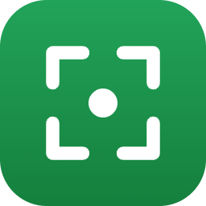

# Capture



Fast area screenshots for macOS, Windows and Chrome. Press a shortcut, drag over part of the screen, mark it up, then copy, save or pin it. Nothing is uploaded.

**Download:** [pageproven.com/capture-app](https://pageproven.com/capture-app)

- Pen, line, arrow, rectangle, ellipse, highlighter and text, in any color and size
- **Pixelate** to hide private details
- **Numbered steps** (1, 2, 3…) for how-to screenshots
- **Pin to screen** (desktop): the capture floats above other windows; drag, zoom, change the opacity
- A magnifier with pixel coordinates and the hex color under the cursor (`C` copies it)
- Full-resolution output on Retina and scaled displays, one capture screen per monitor
- Copy (`Enter`), Save as PNG or JPG (`Ctrl/⌘+S`), instant save (`Ctrl/⌘+Shift+S`)

## Install

**Mac (Apple Silicon and Intel, macOS 12 or later):** open `Capture-mac.dmg` and drag Capture to Applications. Capture isn't signed with an Apple Developer ID yet, so the first time you open it macOS says it can't check it: click **Done**, open **System Settings → Privacy & Security**, scroll down and click **Open Anyway** next to Capture. Then allow **Screen & System Audio Recording** when asked and reopen Capture.

**Windows 10 or 11 (64-bit):** run `Capture-windows-setup.exe`. If Windows shows "Windows protected your PC", click **More info → Run anyway**.

**Chrome, Edge, Brave:** download `Capture-chrome-extension.zip`, unzip it, open `chrome://extensions`, turn on **Developer mode** and click **Load unpacked**.

Capture lives in the menu bar (Mac) or system tray (Windows). Default shortcut: `⌘⇧2` on Mac, `Print Screen` on Windows (others in the tray menu). Extension: click its icon or press `Alt+Shift+S`.

## Keys in the capture screen

| Action | Key |
|---|---|
| Copy and close | `Enter`, `Ctrl/⌘+C`, or double-click the selection |
| Save as… / save instantly | `Ctrl/⌘+S` / `Ctrl/⌘+Shift+S` |
| Pin to screen (desktop) | `Ctrl/⌘+P` |
| Whole screen | `Ctrl/⌘+A` |
| Undo / redo | `Ctrl/⌘+Z` / `Ctrl/⌘+Shift+Z` |
| Move / resize the selection | Arrow keys (`Shift` = 10 px) / `Alt`+Arrow |
| Tools | `V` select, `P` pen, `L` line, `A` arrow, `R` rectangle, `E` ellipse, `M` highlighter, `T` text, `B` pixelate, `N` steps |
| Brush size | Mouse wheel, `[` and `]` |
| Copy the color under the cursor | `C` |
| Cancel | `Esc` or right-click |

`Shift` snaps lines to 45°, draws squares and circles, and keeps the highlighter straight.

A capture screen can never trap you: `Esc` works even without keyboard focus, a capture screen that stops responding closes within 4 seconds, and one that gets no input closes after 15 seconds (60 seconds after the last input).

## Develop

Needs Node.js 22.

```
npm install
npm start            # macOS: launched as its own app so Screen Recording permission attaches to it
npm run selftest     # live test on the real screen (the screen dims a few times)
npm run check        # syntax check
npm run build:extension   # extension/dist/capture-extension/ and the store .zip
npm run icons        # re-render every icon from the logo in assets/make-icons.js
npm run dist:mac     # dist/Capture-mac.dmg (on a Mac)
npm run dist:win     # dist/Capture-windows-setup.exe (on Windows)
```

The log is `~/Library/Application Support/Capture/capture.log` on macOS and `%APPDATA%\Capture\capture.log` on Windows.

```
main.js               tray, shortcut, screen capture, clipboard/save, pinned windows, failsafes
src/preload.js        IPC bridge (listed channels only)
src/overlay.*         the capture screen, shared by the desktop app and the extension
src/pin.*             pinned image window
extension/src/        Chrome extension: background, page injection, browser API for the capture screen
scripts/              dev launcher, live self-test
assets/make-icons.js  the logo and every icon size
```

## Release

1. Bump `version` in `package.json` (and `extension/src/manifest.json` for an extension change).
2. Commit, then `git tag v1.2.3 && git push origin main v1.2.3`.

The **Release** workflow builds the Mac and Windows installers on GitHub's machines and attaches them, with the extension zip, to the release. The download links on the website always point at the latest release (`releases/latest/download/Capture-mac.dmg` and so on), so they don't need changing.
